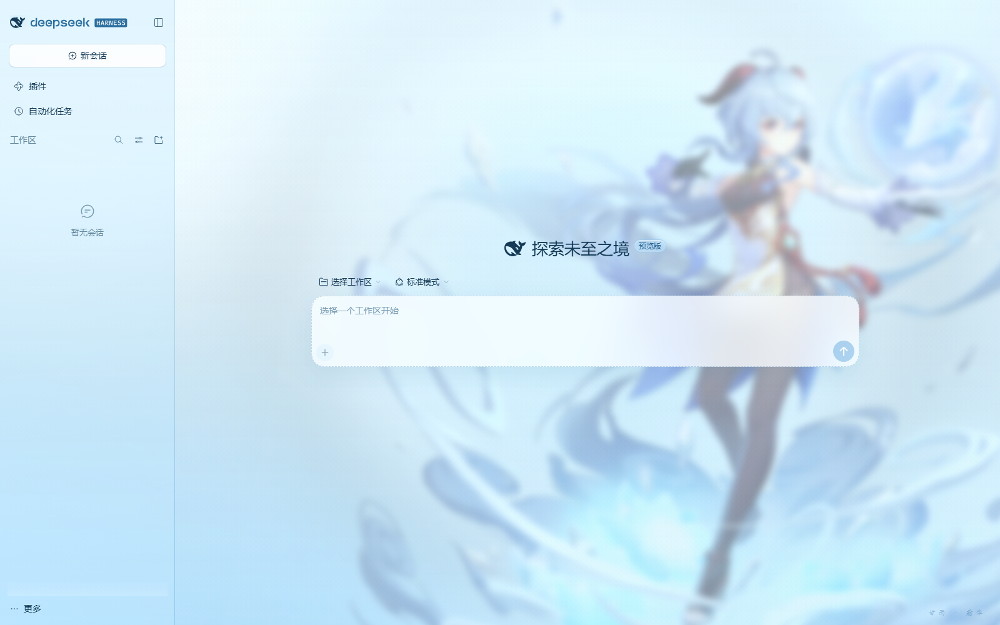
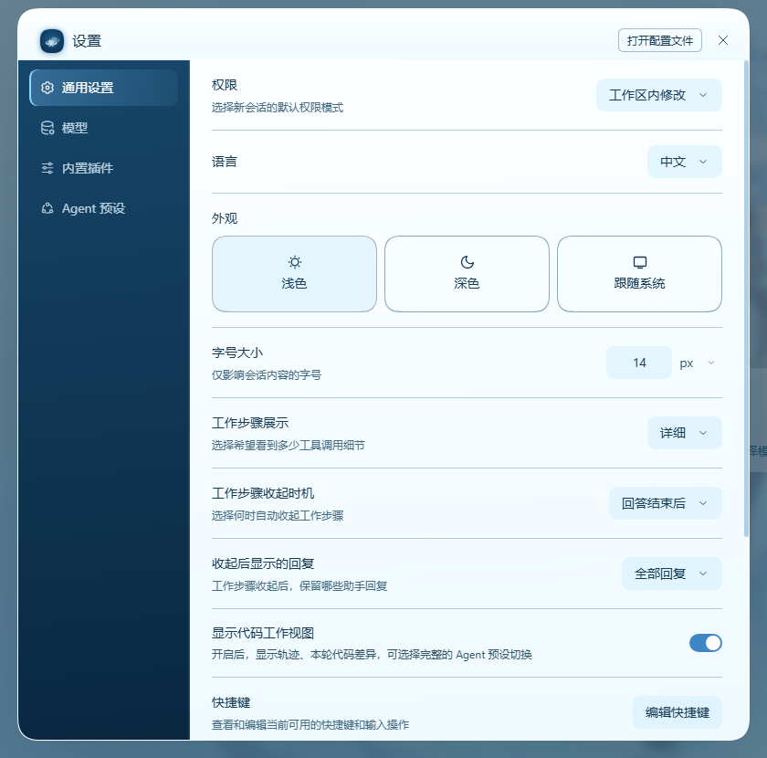
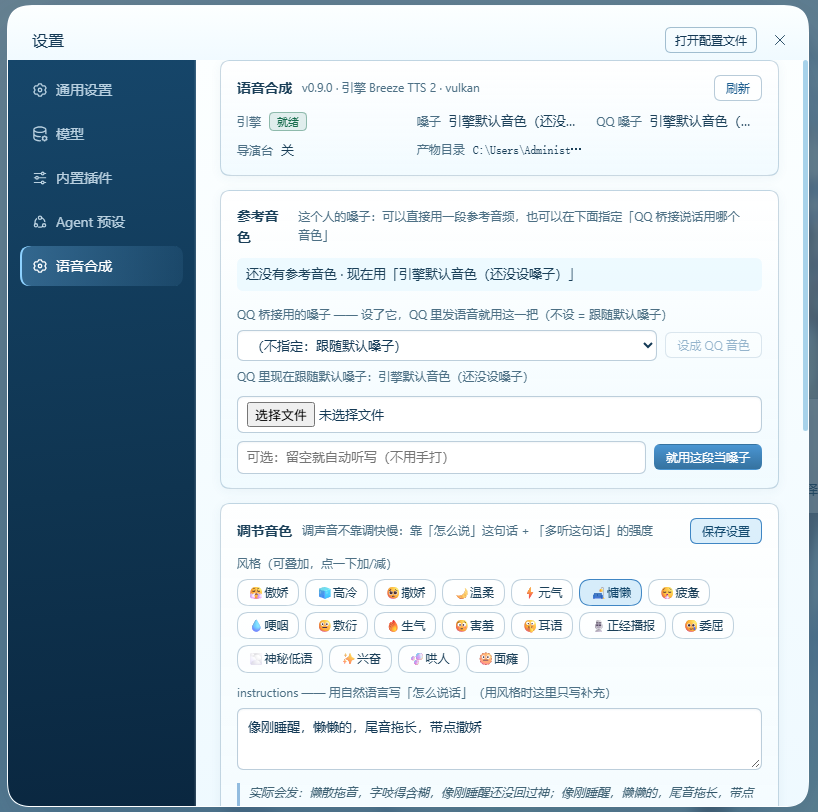
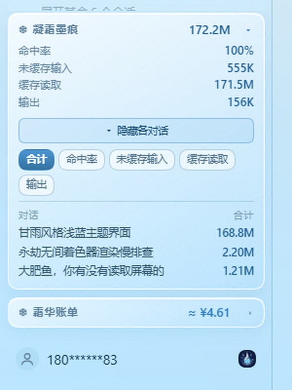
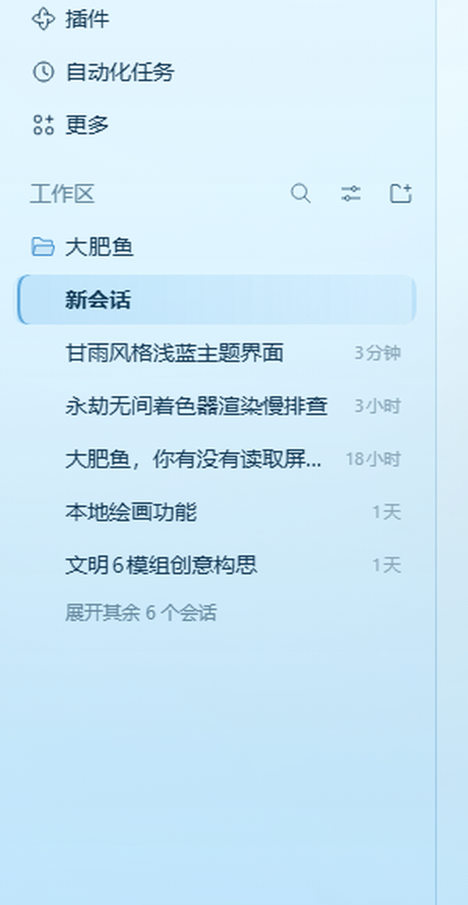
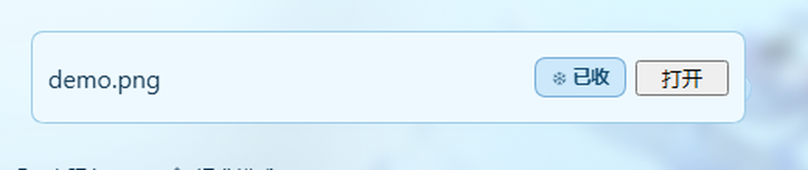

# 甘雨 · 霜华主题（dsh-theme-ganyu）

为 DeepSeek Harness Web / Desktop 界面制作的二次元甘雨风格浅蓝主题。



### 设置界面



设置弹窗改为**不透明霜面 + 深墨蓝导航栏**：内容区是霜白面板，遮罩不模糊、不透出下方页面；左侧分类栏使用深墨蓝渐变（`#16466a → #0a2740`），文字与图标为冰白，选中项带高亮左边条，避免浅蓝叠浅蓝导致的低对比。

同时在设置弹窗内提高了正文/说明文字与描边的对比度：

| 令牌 | 值 |
| --- | --- |
| `--dsw-alias-label-secondary` | `#2f5468` |
| `--dsw-alias-label-tertiary` | `#436b83` |
| `--dsw-alias-border-l1…l4` | 墨水蓝 24%–55% |

### 第三方插件页（语音合成等）



有些第三方插件（如 `dsh-voice-say`）写死了深色底，并且引用了设计系统里**并不存在**的变量名（`--dsw-alias-text`、`--dsw-alias-bg-elevated`、`--dsw-alias-border` 等），于是回退到插件自己的深灰兜底值，在浅蓝界面上就是一块灰。

主题现在做了两件事：

1. 在 `body` 上把这些旧别名映射到真实语义令牌（`label-primary` / `border-l3` / `bg-layer-2` 等），其他写法不规范的插件也能一起受益。
2. 对 `[data-vs-*]` 的语音合成页做显式重绘：卡片改霜白渐变、输入框改白底深字、按钮改霜蓝、标签选中态改冰蓝、徽章改成深色文字配浅底。

对比度也从原来的浅灰字（`#e8ecf5` on 灰底）改成深海军蓝字配白/浅蓝底。

### 设置入口与图标


- **点图标直接开设置**：账户行右端的小图标点击后立刻打开设置，不再先弹账户菜单。
  实现上从账户触发按钮的 React fiber 向上取 `settings.launcher` 的 `openSettings`——
  这正是菜单项本身调用的同一个函数，所以行为一致、只是省掉了菜单闪动。
  （Desktop 的快捷键由原生键盘桥接管，合成按键无效，所以不走快捷键。）
- **账户行图标 = 文明6 徽记**：使用 `ganyu-civ6` 里的
  `ICON_CIVILIZATION_GANYU_256.dds`（银环 + 冰角 + 莲花），圆形裁切。
- **设置标题左侧 = 甘雨青莲**：取自原神官方素材
  [Ganyu 命之座青莲图标](https://enka.network/ui/UI_Talent_S_Ganyu_02.png)，
  做了冰蓝着色，并衬在深蓝圆盘上保证浅色标题栏里也清晰。

### 侧栏余额与今日费用



两张同款卡片，**收起来只有一行**，点一下展开，再点收起：

```
❄ 凝霜墨痕                    106.3M  ▾
❄ 霜华账单                  ≈ ¥3.08  ▾
```

**① 凝霜墨痕** 展开后：

| 行 | 含义 | 事件字段 |
| --- | --- | --- |
| 命中率 | 缓存读取 ÷ 全部计费输入 | — |
| 未缓存输入 | 未命中缓存的输入 | `inputTokens` |
| 缓存读取 | 直接从缓存读出 | `cacheReadTokens` |
| 输出 | 模型输出 | `outputTokens` |

下面一排**指标按钮**（合计 / 命中率 / 未缓存输入 / 缓存读取 / 输出）：
选中哪个，对话列表就按哪个**排序**、并在右侧显示该指标的数值。

指标按钮下面是一条**「展开各对话 / 隐藏各对话」开关**：
各对话消耗默认收起，需要时单独展开，不影响上面的合计读数。

> 所有行共用一个固定数值列宽（`--ganyu-value-col`），
> 所以合计、表头、各对话的数值右边缘严格对齐在同一竖线上。

**② 霜华账单** 展开后显示余额，并按对话列出每段花费。

### 按天统计

`tokenUsage` 投影是**整段对话的终身累计**，直接拿来算「今天」会把跨天老对话的几百兆历史算进去。
现在改为**逐条读会话事件流，按事件时间戳只累加当天**：

- `session.page` 向后翻页，`beforeSeq` 取上一页**最旧事件的 seq**（返回的 `cursor` 是日志末端，不能用来翻页）
- 读到跨过午夜那页即停
- 花费同样只用当日切片计价

> 注意字段名差异：事件里未命中输入叫 `inputTokens`，
> 而 `session/list` 投影里叫 `uncachedInputTokens`。用错会一直读到 0。

### 侧栏会话列表



纯视觉打磨，不改变任何行为：

- **当前会话**：冰蓝渐变底 + 左侧 2px 竖线 + 标题加粗
- **悬停**：整行淡冰蓝高亮
- **时间戳**：右对齐、等宽数字，不再参差
- **行内操作**：默认透明，悬停 / 聚焦时淡入
- **分组标题**：变浅变小，让会话成为视觉主角
- **列表滚动条**：更细更淡

> 选择器用的是 `dsh-client-ui-workspace` 的稳定类名（`sessionRow` / `selected` / `time` / `rowQuickActions`）。


### 雪泥鸿爪（右上角文件收藏）



名字取自「人生到处知何似，应似飞鸿踏雪泥」——留下行迹，日后可取。

右上角一枚圆角长方形按钮 `❄ 雪泥鸿爪`，点开是霜蓝抽屉。

#### 对话内一键收藏

自动识别四类文件呈现方式，鼠标悬停即可点：

| 场景 | 真实结构 | 按钮形态 |
| --- | --- | --- |
| 工具产出的文件卡片 | `[data-presented-file]` | 行内 `❄ 收录`，在「打开」左侧 |
| 消息里的附件 | `[data-message-attachments] [class*="fileCard"]` | 行内 `❄ 收录` |
| 对话中的图片 | `img`（含 `dsh-app://…?path=` 与 `data:` base64） | 图片右侧 `❄ 收录` |
| 蓝色文件链接 | `button[class*="fileMention"]`（**无 href**，路径在 `title`） | 文字后紧凑 `❄` |

几个关键实现点：

- **图片**：按钮与图片包在同一个 `inline-block` 容器里，容器宽高按图片实测尺寸写死，
  所以按钮紧贴图片右侧，且**不在**点击放大的热区之内。
- **文件链接**：DSH 把它渲染成带哈希类名的 `<button>`，没有 `href`，路径只在 `title` 属性。
  解析时按「绝对路径 > 含目录的相对路径 > 裸文件名」排序取最优。
- **去重**：用 `WeakMap` 记住「元素 → 按钮」，并定期清扫锚点已失效的孤儿按钮，
  否则 React 重建节点会让按钮越积越多。
- 收录后变「已收」，**再点一次取消收录**（直接读写 localStorage，不依赖面板是否挂载）。

#### 手动填写与分组

- 输入路径 + 备注名（可空，自动取文件名）
- 顶部胶囊筛选分组；建组填「新建分组」→「建组」
- 每条记录右侧下拉可**移动到任意分组**
- 删组时文件**移到「未分组」**，不删除

#### 打开

点「打开」在**右侧栏预览**，与点 DSH 文件卡片一致：

```js
sidebarRight.openResourceIn(sessionId, address, {})
```

> 不能传 `destination: "sidebar"`——那会走 `placeIn()`，按 `contentId` 复用同一个标签页，
> 导致后开的文件顶掉前一个。不传 destination 走 `place()`，每次新开标签，可同时预览多个文件。

相对路径会按会话 cwd 拼成绝对路径再开，并回写书签。

#### 数据

**只存路径，不复制文件**；数据在 `localStorage`（`dsh-theme-ganyu/marks-v2`）。

面板挂在 `[data-conversation-header-corner]`（会话头部右侧控制区）里，
因为它旁边的 `corner` 插槽已被 DSH 自带的「打开右侧边栏」按钮占用。

#### 排查工具

如果某个文件没出现收藏按钮，在控制台（F12）执行：

```js
ganyuMarksDiag()       // 列出已识别/未识别的文件元素，自动复制到剪贴板
ganyuFindRef('关键字')  // 按文字反查元素，输出 tag/class/属性/祖先链
ganyuMarkRef('关键字')  // 手动兜底：按文字找到文件并直接收录
```

## 效果

- **浅蓝冰霜色调**：整体界面改为低饱和冰蓝，正文深海军蓝，按钮与选中态使用霜蓝强调色。
- **甘雨背景**：2.5K 宽幅甘雨立绘固定在界面底层，右侧留出人物，左侧保持聊天区清爽。
- **30%–50% 自适应模糊**：窗口越宽模糊比例越高；具体映射为
  - 1280px → 30%
  - 1600px → 35%
  - 1920px → 40%
  - 2560px 及以上 → 50%
  - 实际 CSS blur 在 5–8px 之间，避免人物完全糊掉。
- **玻璃质感**：侧栏、会话区、输入框、弹出菜单使用半透明霜白/冰蓝层，背景人物可见。
- **设置界面防透视**：设置弹窗使用不透明霜面 + 深色无模糊遮罩，避免透出下方页面导致文字难辨。
- **侧栏账单**：账户设置上方显示余额与今日费用，余额来自账户接口，今日费用按官方价目表估算。
- **细节**：用户气泡霜蓝、雪晶装饰、冰蓝滚动条、聚焦环、选中文字色、右下角「甘雨 · 霜华」小签名。
- 强制使用浅色主题，保证浅蓝配色在深色系统下也一致。

## 安装状态

主题已经安装到 Desktop profile：

- 包路径：`C:\Users\Administrator\Documents\deepseek-harness\default-workspace\ganyu-theme`
- Profile 依赖：`dsh-theme-ganyu: file:.../ganyu-theme`
- Profile patch：`~/.dsh/profiles/desktop/cordis.patch.yml` 中的 `theme-ganyu` 插入项
- 已通过 HMR 在当前窗口生效

## 重新构建

修改 `src/client.template.js` 或替换 `assets/ganyu-bg.webp` 后：

```powershell
node build.cjs
```

`lib/client.js` 会把 WebP 以 base64 内嵌，因此运行时不需要额外静态资源；改完由 DSH HMR 热加载，或重开应用。

## 文件结构

```
ganyu-theme/
├─ package.json              # dsh.client 声明
├─ build.cjs                 # 将图片内嵌进客户端 bundle
├─ lib/
│  ├─ index.js               # Host 空插件（只为 Loader 提供一行）
│  └─ client.js              # 构建产物（含内嵌图片）
├─ src/
│  └─ client.template.js      # 主题源码：调色板 / CSS / 雪泥鸿爪
├─ assets/
│  ├─ ganyu-bg.webp          # 2.5K 甘雨背景
│  ├─ ganyu-bg-preview.jpg
│  ├─ civ-icon-40.png        # 账户行设置图标（文明6徽记）
│  └─ lotus.png              # 设置导航选中项的青莲
├─ preview.png
├─ settings-preview.png
├─ voice-settings-preview.png
├─ footer-preview.png
├─ billing-preview.png
├─ token-preview.png
├─ sidebar-preview.png
├─ bookmark-preview.png
└─ bookmark-targets.png
```

## 卸载

从 `~/.dsh/profiles/desktop/cordis.patch.yml` 删除：

```yaml
- insert:
    - id: theme-ganyu
      name: dsh-theme-ganyu
```

然后在 Desktop 的插件管理里移除 `dsh-theme-ganyu`，或执行：

```powershell
dsh plugin --profile desktop remove dsh-theme-ganyu
```

## 素材说明

甘雨（Ganyu）角色与立绘版权归 HoYoverse / miHoYo 所有。人物素材取自 Enka Network 的公开 UI 资源（`UI_Gacha_AvatarImg_Ganyu.png`），仅用于个人桌面主题；请勿用于商业分发。主题代码可按需修改自用。
